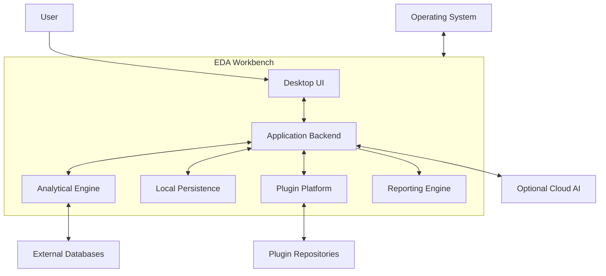

# 02 — System Architecture

**Product:** EDA Workbench  
**Document Type:** System Architecture Specification  
**Version:** 0.4 — Draft for Review  
**Status:** Draft for Review — Revised for Review (WP-15)  
**Depends On:** Document 01 — Product Vision & Requirements; Document 05 v0.2; Document 06 v0.2; Document 11 v0.3; Document 12 v0.2

> **Revision note (WP-12):** v0.2 aligns this system-level specification with the canonical backend-authoritative job lifecycle (Doc05 §8), typed IPC contracts (Doc06 §§5–6, 13), default-deny authorization (Doc11 §7 / SEC-004 Proposed), audit-vs-provenance separation (Doc11 §14 / SEC-012; Doc12 §17), and payload-bound export policy (Doc11 §15 / SEC-013; Doc12 §15). No new runtime technology is selected. Decisions introduced here remain **Proposed** until source-owner review and PO ratification.

---

## 1. Architecture Vision

EDA Workbench uses a **Python-native desktop host with a modular monolithic backend and a React-based frontend**.

The architecture provides:

- Clear separation between presentation, application orchestration, domain logic, and infrastructure.
    
- Explicit module boundaries and dependency ownership.
    
- Reliable communication between JavaScript and Python.
    
- Background execution for expensive analytical operations.
    
- Local-first persistence and analytical processing.
    
- Extensible analytical capabilities through governed plugin contracts.
    
- Reproducible analytical execution and traceable artifacts.
    
- Cross-platform desktop deployment.
    

### 1.1 Core Architectural Principle

**One application, one modular backend, clearly separated responsibilities, and explicit contracts between modules.**

The system should remain simple to deploy and operate while preserving the ability to evolve individual capabilities independently.

---

## 2. Architecture Decisions

|ID|Decision|Selected Approach|
|---|---|---|
|SYS-001|Overall architecture|Modular Monolith|
|SYS-002|Desktop host|PyWebView|
|SYS-003|Frontend|React + TypeScript + Vite|
|SYS-004|Backend|Python|
|SYS-005|Frontend/backend communication|PyWebView JS-Python Bridge|
|SYS-006|Backend API model|Typed Command/Query Contracts|
|SYS-007|Execution|Hybrid AsyncIO, Threads, and Processes|
|SYS-008|Background work|Centralized Job Manager|
|SYS-009|Event infrastructure|Governed Local Event Architecture|
|SYS-010|Dependency management|Composition Root + Constructor Injection|
|SYS-011|Persistence|SQLite + Parquet + Filesystem|
|SYS-012|Analytical query engine|DuckDB + Adaptive Processing|
|SYS-013|Data exchange|JSON + Apache Arrow|
|SYS-014|Deployment|Platform-Native Desktop Packaging|
|SYS-015|Job lifecycle authority|Backend-authoritative Job Manager; frontend is a projection, never the source of truth (Doc05 §8)|
|SYS-016|IPC contract source|Python/Pydantic schemas; TypeScript types generated, never hand-edited (Doc06 §6)|
|SYS-017|Authorization|Default-deny at trusted service boundaries (SEC-004, Proposed)|
|SYS-018|Evidence separation|Security audit (Doc11 §14) and execution provenance (Doc05 §15, Doc12 §17) are distinct records, correlated by stable identifiers|
|SYS-019|Export policy binding|Policy evaluation is bound to the final payload and destination; material change invalidates the decision (Doc12 §15, SEC-013 Proposed)|

These decisions establish the architectural baseline for subsequent specifications.

---

## 3. System Context & Boundaries

### 3.1 System Boundary

EDA Workbench consists of the following major areas:

**Inside the application boundary:**

- Desktop application host.
    
- Frontend presentation layer.
    
- Application orchestration layer.
    
- Domain modules.
    
- Analytical processing engine.
    
- Job and event infrastructure.
    
- Persistence and storage services.
    
- Plugin management and execution infrastructure.
    
- Trusted service authorization boundary (default-deny).
    
- Security audit service and execution provenance records (distinct, correlated).
    
- Export Manager (payload-bound policy evaluation).
    
- AI integration layer.
    
- Reporting and export services.
    

**Outside the application boundary:**

- Operating system.
    
- Local filesystem.
    
- External databases.
    
- Optional cloud AI providers.
    
- Optional remote data sources.
    
- External plugin repositories.
    
- External report consumers.
    

### 3.2 Context Diagram



External integrations are optional capabilities. Core EDA must remain functional without cloud AI, remote databases, or plugin repositories.

---

## 4. High-Level Component Architecture

The application is divided into six architectural layers.

### Layer 1 — Presentation

Responsibilities:

- Render application interface.
    
- Manage user interactions.
    
- Display datasets, artifacts, findings, and reports.
    
- Provide Guided and Advanced experiences.
    
- Display job progress and application events.
    
- Manage ephemeral UI state.
    

Technology:

- React.
    
- TypeScript.
    
- Vite.
    
- Apache ECharts.
    
- TanStack Query.
    
- Zustand.
    
- React Hook Form (FE-011, Proposed — Doc07 §18; IN-H closed at decision level in WP-15).
    

The frontend must not access SQLite, Parquet files, or internal backend objects directly.

### Layer 2 — Desktop Integration

Responsibilities:

- Initialize PyWebView.
    
- Load the trusted frontend.
    
- Expose the JavaScript-Python bridge.
    
- Handle native dialogs and desktop integrations.
    
- Manage application startup and shutdown.
    
- Enforce trusted UI navigation boundaries.
    

Technology:

- PyWebView.
    
- Narrow typed JavaScript-Python bridge.
    
- Platform-specific desktop adapters.
    

The bridge is a controlled application boundary, not a general-purpose Python execution interface.

### Layer 3 — Application Orchestration

Responsibilities:

- Coordinate user commands and queries.
    
- Enforce application-level policies.
    
- Coordinate multiple domain modules.
    
- Manage workflows and Analysis Plans.
    
- Schedule background jobs.
    
- Coordinate transactions.
    
- Publish application events.
    

Contains:

- Application Services.
    
- Command Handlers.
    
- Query Handlers.
    
- Workflow Orchestrators.
    
- Job Manager.
    
- Application Event Coordination.
    

This layer coordinates domain operations without owning all domain rules.

### Layer 4 — Domain

Responsibilities:

- Maintain business rules and invariants.
    
- Represent domain entities and value objects.
    
- Validate state transitions.
    
- Define domain-owned interfaces.
    
- Emit domain events where appropriate.
    

Major domain areas:

- Projects.
    
- Datasets.
    
- Data Quality.
    
- Transformations.
    
- Analysis.
    
- Statistical Methods.
    
- Visualization.
    
- Insights and Findings.
    
- Reporting.
    
- Plugins.
    
- AI Governance.
    

Domain logic must not depend directly on React, PyWebView, or infrastructure implementations.

### Layer 5 — Analytical & Execution Infrastructure

Responsibilities:

- Execute analytical queries.
    
- Process large datasets.
    
- Evaluate transformation pipelines.
    
- Run statistical algorithms.
    
- Perform profiling and anomaly detection.
    
- Manage analytical resource consumption.
    
- Exchange data between processing components.
    

Technology:

- DuckDB.
    
- Polars.
    
- pandas where appropriate.
    
- Apache Arrow.
    
- Python scientific libraries.
    
- Adaptive Query Planner.
    
- Execution Scheduler.
    

The selected engine must depend on workload requirements and declared execution capabilities.

### Layer 6 — Infrastructure & Persistence

Responsibilities:

- Persist project metadata.
    
- Manage immutable snapshots.
    
- Store analytical artifacts.
    
- Manage cache.
    
- Access external data sources.
    
- Handle backup and recovery.
    
- Manage credentials and configuration.
    
- Provide logging and diagnostics.
    

Technology:

- SQLite.
    
- Parquet.
    
- Filesystem.
    
- DuckDB.
    
- OS credential stores.
    

Infrastructure implementations are accessed through defined interfaces rather than directly by domain modules.

---

## 5. Backend Module Architecture

The backend is a modular monolith organized by business capability.

### 5.1 Core Modules

|Module|Primary Responsibility|
|---|---|
|Project Management|Project lifecycle and configuration|
|Data Management|Sources, datasets, schemas, snapshots|
|Data Quality|Profiling and quality assessment|
|Transformation|Cleaning operations and pipelines|
|Analysis|Statistical methods and analytical execution|
|Visualization|Visualization specifications and artifacts|
|Workflow|Guided stages and Analysis Plans|
|Insights|Observations, findings, hypotheses|
|AI Platform|AI providers, routing, governance|
|Plugin Platform|Extension discovery, validation, execution|
|Reporting|Report generation and export|
|Platform Services|Jobs, events, persistence, diagnostics, security|

### 5.2 Module Ownership

Every module must own:

- Its domain models.
    
- Its business rules.
    
- Its application-facing interfaces.
    
- Its validation rules.
    
- Its persistence abstractions where appropriate.
    
- Its domain events.
    
- Its tests.
    

A module must not modify another module's internal state by directly accessing its implementation details.

Cross-module interaction occurs through explicit interfaces, application services, or governed events.

### 5.3 Dependency Direction

```
flowchart TB
    P["Presentation"]
    D["Desktop Integration"]
    A["Application Orchestration"]
    DOM["Domain Modules"]
    PORTS["Defined Interfaces / Ports"]
    INFRA["Infrastructure Adapters"]
    EXEC["Analytical Execution"]

    P --> D
    D --> A
    A --> DOM
    A --> EXEC
    A --> PORTS
    INFRA --> PORTS
    EXEC --> PORTS
```

Dependency rules:

1. Domain modules do not depend on presentation.
    
2. Domain modules do not depend on infrastructure implementations.
    
3. Application services coordinate domain modules.
    
4. Infrastructure implements defined contracts.
    
5. Modules avoid circular dependencies.
    
6. Cross-module operations use explicit application-level coordination.
    
7. Shared utilities must not become an uncontrolled shared domain model.
    

---

## 6. Runtime Architecture

### 6.1 Desktop Runtime

The application uses a Python desktop host.

Startup sequence:

1. Start Python application entry point.
    
2. Load configuration and environment.
    
3. Initialize logging and diagnostics.
    
4. Initialize the application composition root.
    
5. Initialize persistence and project infrastructure.
    
6. Register application services and bridge API.
    
7. Create the PyWebView window.
    
8. Load bundled frontend assets.
    
9. Wait for the WebView ready event.
    
10. Initialize frontend application state.
    

The frontend must wait for `window.pywebviewready` before invoking bridge methods.

### 6.2 Production vs Development

**Development:**

- Vite development server.
    
- Local trusted development UI.
    
- Python backend host.
    
- Development diagnostics.
    

**Production:**

- Bundled frontend assets.
    
- PyWebView internal local asset serving.
    
- No dependency on an external Node.js runtime.
    
- No use of `file://` as the primary production frontend origin.
    

External navigation opens in the system browser rather than gaining access to the privileged application bridge.

### 6.3 Runtime Process Model

The primary desktop application runs as one Python host process.

Additional processes may be created for:

- CPU-intensive analytical workloads.
    
- Isolated third-party plugins.
    
- Ad-hoc scripts.
    
- Future specialized execution runtimes.
    

A subprocess is not automatically a secure sandbox. Isolation requires operating-system-level controls and explicit permissions.

---

## 7. Frontend-Backend Communication

### 7.1 Communication Model

The frontend communicates through a narrow typed bridge:

`window.pywebview.api.method_name(...)`

The bridge exposes approved application operations, not arbitrary internal Python objects or execution capabilities.

### 7.2 Command/Query Separation

**Commands:**

Operations that change application state.

Examples:

- Create project.
    
- Import dataset.
    
- Configure transformation.
    
- Approve Analysis Plan.
    
- Start analysis.
    
- Generate report.
    

**Queries:**

Operations that retrieve application state.

Examples:

- Get project details.
    
- Preview dataset.
    
- Retrieve profiling results.
    
- List artifacts.
    
- Inspect job status.
    

### 7.3 Contract Requirements

Every bridge operation must have:

- Typed input (Pydantic canonical schema; generated TypeScript types are not hand-edited — Doc06 §6).
    
- Validated parameters.
    
- Defined output.
    
- Stable error representation.
    
- Authorization checks.
    
- Version compatibility.
    
- Request correlation.
    

The common response envelope contains:

- `request_id`
    
- `success`
    
- `data`
    
- `error`
    
- `metadata`
    

Identifiers have distinct responsibilities (Doc06 §13): `request_id` identifies one IPC request/response exchange; `correlation_id` links related commands, events, and downstream operations; `idempotency_key` identifies a logical command submission for safe retry. They are not interchangeable. A repeated idempotency key with the same canonical request returns the original acceptance/result; with materially different content it returns a conflict. Rejection creates no attempt.

Long-running operations return a `job_id` rather than blocking the bridge. Cancellation is cooperative: the UI reflects `Cancelling` until the backend reports a durable `JobCancelled` outcome.

Large tabular data must not be serialized as unrestricted JSON.

Use bounded previews, pagination, Arrow IPC, and controlled artifact references.

### 7.4 Thread Safety

PyWebView exposed functions may execute in separate threads.

Therefore:

- Bridge handlers must not assume sequential invocation.
    
- Shared state requires explicit coordination.
    
- Project writes go through the serialized write coordinator.
    
- Long-running work is delegated to the Job Manager.
    
- UI and IPC threads must not perform heavy analytical work.
    

---

## 8. Execution & Concurrency Architecture

The system uses a hybrid concurrency model.

|Workload|Execution Model|
|---|---|
|I/O orchestration|AsyncIO|
|Blocking I/O|Worker threads|
|CPU-intensive processing|ProcessPool with spawn|
|Untrusted plugins/scripts|Isolated subprocess|
|Short synchronous operations|Direct execution when safe|

### 8.1 Job Manager

The Job Manager is responsible for:

- Job creation and identification.
    
- Scheduling.
    
- Execution state.
    
- Progress reporting.
    
- Cancellation.
    
- Error handling.
    
- Resource budgets.
    
- Persistence of job metadata.
    
- Recovery of interrupted work.
    

### 8.2 Job Lifecycle

The lifecycle below is canonical with Doc05 §8.2 (backend-authoritative). Doc02 does not redefine it; any conflict is resolved in favour of Doc05.

```
stateDiagram-v2
    [*] --> Created
    Created --> Queued
    Queued --> Preparing
    Preparing --> Running
    Running --> Completed
    Running --> Failed
    Running --> Cancelling
    Cancelling --> Cancelled
    Running --> Interrupted
    Interrupted --> RecoveryEvaluation
    RecoveryEvaluation --> Queued
    RecoveryEvaluation --> Failed
    Completed --> [*]
    Failed --> [*]
    Cancelled --> [*]
```

Rules:

- `WaitingForResource` and `WaitingForApproval` are non-terminal waiting states.
    
- `PartiallyCompleted` is an outcome only where the job contract explicitly permits valid partial output; it must not be treated as `Completed`.
    
- Terminal outcomes are `Completed`, `Failed`, `Cancelled`, and conditionally `PartiallyCompleted`.
    
- `Interrupted` records execution interrupted before a terminal outcome and initiates recovery evaluation; it is not evidence of successful completion.
    
- Interrupted jobs are not automatically resumed. Resumption depends on operation semantics, execution checkpoints, and idempotency.

Canonical durable lifecycle events (Doc05 §8.2.1): `JobCreated`, `JobQueued`, `JobStarted`, `JobCancellationRequested`, `JobCancelled`, `JobCompleted`, `JobFailed`, `JobInterrupted`, `JobRecoveryCompleted`. `JobProgressUpdated` and task-level events are ephemeral unless separately specified as durable. Each durable transition identifies `job_id`, resulting state, timestamp, event identity/version, and correlation context; consumers must not observe a durable terminal event for a transition that was not persisted.

### 8.3 Adaptive Execution

The Query Planner chooses appropriate execution strategies based on:

- Dataset characteristics.
    
- Provider capabilities.
    
- Query complexity.
    
- Estimated memory and CPU.
    
- Available storage.
    
- Execution requirements.
    
- Exact versus approximate requirements.
    

Execution choices must be explainable and recorded for reproducibility.

---

## 9. Event Architecture

The application uses a governed local event architecture.

### 9.1 Event Categories

**Critical persistent events:**

- Project state changes.
    
- Dataset snapshot creation.
    
- Pipeline execution results.
    
- Artifact creation.
    
- Important workflow transitions.
    

**Ephemeral events:**

- Job progress.
    
- Temporary UI notifications.
    
- Live execution status.
    

### 9.2 Event Infrastructure

- SQLite-backed persistence for critical events.
    
- In-memory event bus for local dispatch.
    
- Versioned event schemas.
    
- Event ownership and compatibility rules.
    
- Idempotent event consumers.
    
- Sequence tracking and deduplication.
    
- Reconciliation after WebView reload.
    

### 9.3 Event Delivery

The frontend may disconnect and reconnect without losing critical state.

On reconnection:

1. Establish event subscription.
    
2. Detect last acknowledged sequence.
    
3. Retrieve missed critical events or reconcile state.
    
4. Deduplicate previously received events.
    
5. Resume live event processing.
    

No external message broker is required for MVP.

---

## 10. Data & Persistence Architecture Overview

The system uses polyglot persistence with clear responsibilities.

|Technology|Responsibility|
|---|---|
|SQLite|Project metadata, relationships, job records, artifact metadata, critical events|
|Parquet|Immutable analytical snapshots|
|Filesystem|Reports, exports, plugin packages, managed payloads|
|DuckDB|Analytical querying and transformation execution|
|Apache Arrow|Inter-component tabular data exchange|
|Local cache|Rebuildable intermediate results|

### 10.1 Project Isolation

Each project owns its own:

- `project.db`
    
- Managed datasets and snapshots.
    
- Artifacts.
    
- Reports.
    
- Project configuration.
    
- Cache.
    

Application-level services own global settings, plugin registry, shared templates, and shared infrastructure.

Projects do not automatically access each other's data.

### 10.2 Persistence Rules

- SQLite WAL mode.
    
- Serialized write coordinator per project.
    
- Short-lived read operations.
    
- Explicit Unit of Work.
    
- Atomic file staging.
    
- Immutable snapshots and artifacts.
    
- Transaction-aware backup and recovery.
    

Detailed schemas and persistence contracts are defined in Document 04.

---

## 11. Security & Trust Boundaries

Security is enforced across all major system boundaries.

### 11.1 Trust Zones

**Zone A — Trusted Application UI**

Bundled frontend with access to approved bridge operations.

**Zone B — Application Backend**

Internal domain and application services operating under application policies.

**Zone C — Local Data & Storage**

Project data, credentials, reports, artifacts, and cache.

**Zone D — Third-Party Extensions**

Plugins and scripts with explicit permissions and isolation requirements.

**Zone E — External Services**

Remote databases, cloud AI providers, and external repositories.

### 11.2 Core Security Requirements

- Default-deny for every protected operation at trusted service boundaries (SEC-004, **Proposed** — not yet ratified).
    
- Controlled outbound network access with destination and resolved-address validation (SEC-011, **Proposed**).
    
- Structured security audit events with actor attribution, policy decision vs enforcement outcome, correlation, and privacy controls (SEC-012, **Proposed**; Doc11 §14).
    
- Classification-aware export protection with payload-bound policy enforcement (SEC-013, **Proposed**; Doc11 §15, Doc12 §15).
    
- Security audit and execution provenance are distinct records with distinct ownership; they are correlated by stable identifiers and must not be conflated (SYS-018).

- Strict WebView navigation boundaries.
    
- Controlled JavaScript-Python bridge.
    
- Input validation at IPC boundaries.
    
- Default-deny capability permissions.
    
- Least-privilege execution.
    
- Secure credential storage.
    
- Plugin isolation.
    
- AI prompt-injection and tool authorization defenses.
    
- Sensitive-data classification.
    
- Auditability for important operations.
    

Detailed threat models and security controls are specified in Document 11.

---

## 12. Application Lifecycle

### 12.1 Startup

Startup must respect dependency ordering.

Critical infrastructure is initialized before dependent application services become available.

### 12.2 Runtime Health (canonical reference — WP-14, IN-C resolution)

Health vocabulary is owned by Document 15 §9.1. Services expose the canonical health axis: `Starting`, `Healthy`, `Degraded`, `Unhealthy`, `Stopping`, `Disabled` — and, separately, an availability/readiness axis (`Ready`/`Available` vs `Unavailable`) per Doc15 §9.3. Legacy terms in this document's earlier versions map as follows: `Initializing` → `Starting`; `Ready` → readiness axis (not health); `Failed` → `Unhealthy`; `Shutting Down` → `Stopping`. See Doc06 §14 for the IPC-facing presentation of the same model.

Optional integrations may fail without preventing core EDA functionality.

### 12.3 Shutdown

Shutdown sequence:

1. Stop accepting new commands.
    
2. Notify active jobs and application services.
    
3. Apply safe cancellation or completion policies.
    
4. Persist final job and session state.
    
5. Flush critical events.
    
6. Complete or safely stage pending persistence operations.
    
7. Close project resources.
    
8. Checkpoint/close SQLite connections where appropriate.
    
9. Release desktop resources.
    
10. Exit the application.
    

Forced termination must be recoverable through persistence and recovery mechanisms.

---

## 13. Observability

Three evidence planes are kept distinct (SYS-018): (1) **security audit** — actor, action, resource, policy decision vs enforcement outcome (Doc11 §14); (2) **execution provenance** — what ran, on which inputs/revisions, with which outputs (Doc05 §15, Doc12 §17); (3) **diagnostic telemetry** — operational signals for troubleshooting. Sharing correlation identifiers across planes does not merge them. The Shared Provenance Envelope is a shared conceptual model (Doc09 §13.2.2); field-level mapping remains open (F-02).

The system provides local-first observability.

### Local observability

- Structured logs.
    
- Error traces.
    
- Job execution metrics.
    
- Query performance.
    
- Memory and CPU usage.
    
- Plugin failures.
    
- AI provider status.
    
- IPC latency.
    
- Startup and shutdown performance.
    

### Diagnostic collection

- User-controlled diagnostic bundle.
    
- Preview before export.
    
- Sensitive data redaction.
    
- No dataset values by default.
    

### Product telemetry

- Strictly opt-in.
    
- Separate from operational logging.
    
- No raw dataset upload by default.
    
- No dependency for core application functionality.
    

---

## 14. Deployment Architecture

### 14.1 Distribution

Platform-native packaging:

- Windows: `.exe` / `.msi`.
    
- macOS: `.app` / `.dmg`.
    
- Linux: AppImage and optional `.deb`.
    

The distribution bundles:

- Python runtime.
    
- Python dependencies.
    
- PyWebView.
    
- Frontend production assets.
    
- Required application resources.
    

No externally installed Python or Node.js runtime should be required for standard users.

### 14.2 Cross-Platform Compatibility

Platform adapters handle differences in:

- WebView runtime.
    
- Native dialogs.
    
- Filesystem behavior.
    
- Credentials.
    
- Keyboard conventions.
    
- Installation and updates.
    

Windows, macOS, and Linux must be tested throughout development, not only before release.

---

## 15. Architectural Quality Attributes

|Attribute|Architectural Response|
|---|---|
|Modularity|Domain-oriented modular monolith|
|Maintainability|Explicit module ownership and contracts|
|Performance|Adaptive execution and background jobs|
|Scalability|Large-dataset processing strategies|
|Reliability|Transactional persistence and recovery|
|Reproducibility|Immutable snapshots, artifacts, and execution records|
|Security|Defense in depth and controlled capabilities|
|Privacy|Local-first processing and explicit consent|
|Extensibility|Governed plugin contracts|
|Accessibility|Accessible frontend architecture|
|Portability|Platform-native packaging and portable projects|
|Testability|Layered testing and contract validation|

---

## 16. Architecture Constraints & Anti-Patterns

The following are explicitly prohibited architectural shortcuts:

1. Turning the MVP into a microservices system.
    
2. Allowing frontend components to access backend persistence directly.
    
3. Exposing unrestricted Python execution through IPC.
    
4. Transferring entire DataFrames through JSON.
    
5. Running expensive analytical tasks on the UI or bridge thread.
    
6. Allowing arbitrary cross-module state mutation.
    
7. Creating circular domain dependencies.
    
8. Using the cache as the authoritative source of analytical truth.
    
9. Treating subprocess execution as sufficient plugin sandboxing.
    
10. Automatically falling back to cloud AI without consent.
    
11. Silently switching exact analytical operations to approximate execution.
    
12. Allowing optional integrations to prevent core EDA from operating.
    
13. Treating frontend job state as the authoritative job lifecycle (SYS-015 — backend Job Manager is authoritative).
    
14. Reusing an export policy decision after a material payload or destination change (SYS-019).
    
15. Conflating security audit with execution provenance or diagnostic telemetry (SYS-018).
    
16. Hand-editing generated TypeScript IPC types instead of regenerating from Pydantic schemas (SYS-016).
    
17. Treating acknowledgement as authorization, or a warning as overriding a deny decision (Doc11 §15.2).
    

---

## 17. Architecture Traceability

|Requirement Area|Architecture Response|Detailed Specification|
|---|---|---|
|Guided and Advanced UX|Shared backend and domain services|Document 07, 08|
|Local-first operation|Local persistence and execution|Document 04|
|Large datasets|Adaptive execution architecture|Document 05|
|Reproducibility|Immutable snapshots and artifacts|Document 04, 12|
|Extensibility|Governed plugin architecture|Document 09|
|AI assistance|Provider abstraction and governance|Document 10|
|Security|Trust boundaries, default-deny, audit, payload-bound export|Document 11 v0.3|
|Job lifecycle & retry|Backend-authoritative Job Manager, durable events|Document 05 v0.2|
|IPC contracts|Typed Pydantic contracts, idempotency, protocol versioning|Document 06 v0.2|
|Export provenance|Payload-bound policy, distinct provenance vs audit|Document 12 v0.2|
|Analytical correctness|Statistical engine and quality tests|Document 13|
|Desktop deployment|PyWebView and native packaging|Document 14|

---

## 18. Open Design Items

The following are intentionally deferred to detailed specifications:

1. Exact domain entities, relationships, and bounded-context ownership — Document 03.
    
2. SQLite schemas, file layout, snapshot storage, and migrations — Document 04.
    
3. Query planner algorithms, execution policies, and resource budgets — Document 05.
    
4. Exact IPC schemas and version compatibility — Document 06.
    
5. Frontend component and state organization — Document 07.
    
6. Plugin contracts and runtime isolation — Document 09.
    
7. AI provider interfaces and routing — Document 10.
    
8. Detailed threat model and permission policy — Document 11.
    
9. Workflow and screen-level behavior — Document 08.
    
10. Artifact schemas and reporting lifecycle — Document 12.
    

These items are not unresolved contradictions. They are deliberate boundaries between architecture documents.

Alignment items carried from WP-09/WP-10 (not contradictions):

- F-02: Shared Provenance Envelope remains conceptual; field-level mapping per domain is deferred to Phase 2.
    
- IN-A: CLOSED in WP-13 (Polars = execution adapter; Parquet = storage; Arrow = interchange — Doc04 §10.2). Doc00 §2.3 editorial sync remains for WP-17.
    
- SYS-015 to SYS-019 and SEC-004/011/012/013 remain Proposed pending source-owner review and PO ratification (WP-11 Batch B-02).

---

## 19. Definition of Architecture Completion

This specification is considered complete when:

- System boundaries are explicit.
    
- Architectural layers and responsibilities are defined.
    
- Module ownership is established.
    
- Dependency direction is documented.
    
- Runtime and process model are defined.
    
- Frontend/backend communication model is defined.
    
- Execution and event architecture are established.
    
- Persistence responsibilities are assigned.
    
- Trust boundaries are identified.
    
- Lifecycle and deployment architecture are described.
    
- Major decisions are traceable to the product requirements.
    
- Job lifecycle matches Doc05 §8.2 canonical states and durable events.
    
- IPC identifier semantics (`request_id` / `correlation_id` / `idempotency_key`) match Doc06 §13.
    
- Security requirements distinguish Confirmed decisions from Proposed (SEC-004/011/012/013) without promoting them.
    
- Audit, provenance, and telemetry are documented as distinct evidence planes (SYS-018).
    

**Final Architecture Principle:**

EDA Workbench is a local-first, Python-native desktop application built as a domain-oriented modular monolith. Its architecture separates presentation, orchestration, domain logic, analytical execution, and infrastructure through explicit contracts, enabling reliable, reproducible, secure, and extensible EDA without unnecessary distributed-system complexity.
